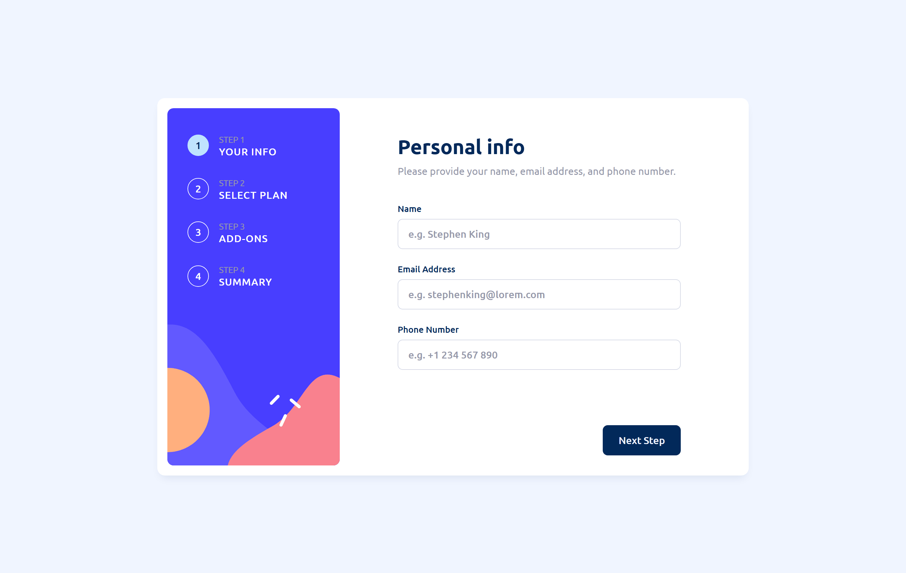
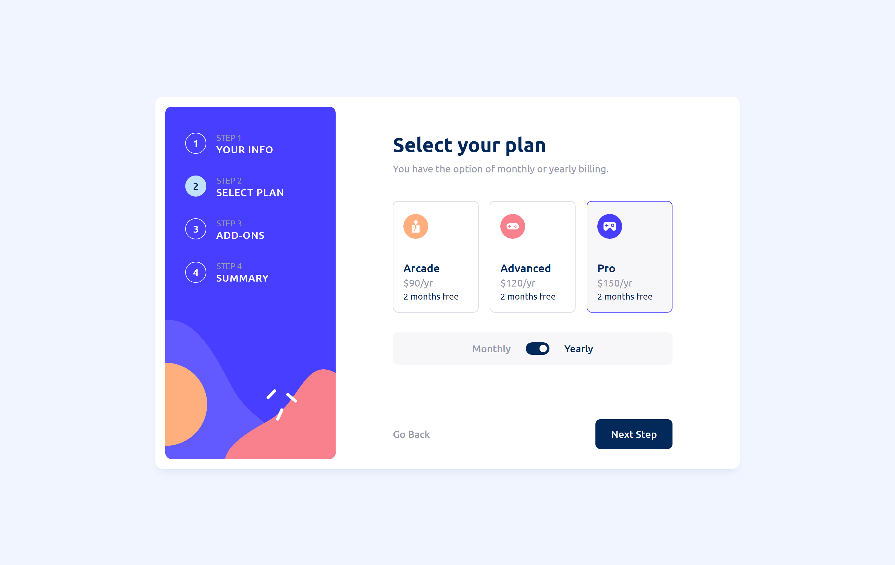
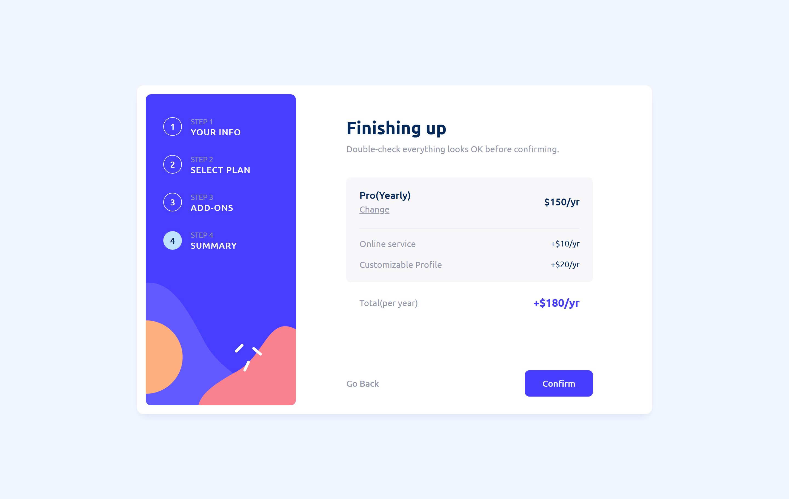
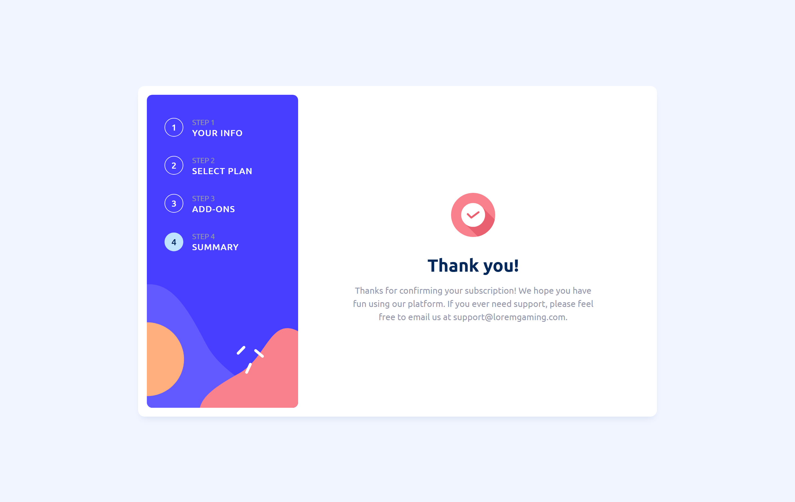

# Frontend Mentor - Multi-step form solution

This is a solution to the [Multi-step form challenge on Frontend Mentor](https://www.frontendmentor.io/challenges/multistep-form-YVAnSdqQBJ).

## Table of contents

- [Overview](#overview)
  - [The challenge](#the-challenge)
  - [Screenshot](#screenshot)
  - [Links](#links)
- [My process](#my-process)
  - [Built with](#built-with)
  - [What I learned](#what-i-learned)
  - [Continued development](#continued-development)
  - [Useful resources](#useful-resources)
- [Author](#author)

## Overview

### The challenge

Users should be able to:

- Complete each step of the sequence
- Go back to a previous step to update their selections
- See a summary of their selections on the final step and confirm their order
- View the optimal layout for the interface depending on their device's screen size
- See hover and focus states for all interactive elements on the page
- Receive form validation messages if:
  - A field has been missed
  - The email address is not formatted correctly
  - A step is submitted, but no selection has been made

### Screenshot

|                                             Info Step                                              |                                              Plans Step                                              |
| :------------------------------------------------------------------------------------------------: | :--------------------------------------------------------------------------------------------------: |
|  |  |

|                                              Add-ons Step                                               |                                               Summary Step                                               |
| :-----------------------------------------------------------------------------------------------------: | :------------------------------------------------------------------------------------------------------: |
|  |  |

|                                                Submission Step                                                |
| :-----------------------------------------------------------------------------------------------------------: |
|  |

### Links

- [Solution URL Here](https://github.com/mustafa-abu-eisha/multi-step-form-ts)
- [Live Site URL Here](https://multi-step-form-ts-live.pages.dev/)

## My process

### Built with

- Semantic HTML5 markup
- Mobile-first workflow
- [React](https://reactjs.org/) - UI library
- [TypeScript](https://www.typescriptlang.org/) - Typed JavaScript
- [Tailwind CSS](https://tailwindcss.com/) - Utility-first CSS framework
- [Vite](https://vitejs.dev/) - Frontend build tool

### What I learned

Building this multi-step form with TypeScript and Tailwind CSS helped me structure complex form state cleanly, enforce strict types across steps and user selections, and handle field-level validation with clear error states.

```tsx
type BillingCycle = "monthly" | "yearly";

export interface PaymentInfoTypes {
  userInfo: UserInfoTypes;
  planName: string;
  paymentSystem: BillingCycle;
  addOns: AddOnsTypes[];
}
```

### Continued development

In future iterations, I plan to refine form accessibility (such as ARIA attributes and keyboard navigation between steps) and explore schema-based validation patterns for larger multi-step workflows.

### Useful resources

- [React Documentation](https://react.dev/) - Helpful for managing component state and step transitions cleanly.
- [TypeScript Handbook](https://www.typescriptlang.org/docs/) - Useful reference for typing form state, props, and validation helpers.
- [Tailwind CSS Documentation](https://tailwindcss.com/docs) - Great reference for responsive layouts, spacing, and interactive states.

## Author

- [Frontend Mentor Profile](https://www.frontendmentor.io/profile/mustafa-abu-eisha)
- [GitHub Profile](https://github.com/mustafa-abu-eisha)
- [LinkedIn Profile](https://www.linkedin.com/in/mustafaabueisha)

## Acknowledgments

Thanks to Frontend Mentor for providing realistic design challenges that help improve frontend development skills through hands-on practice.
